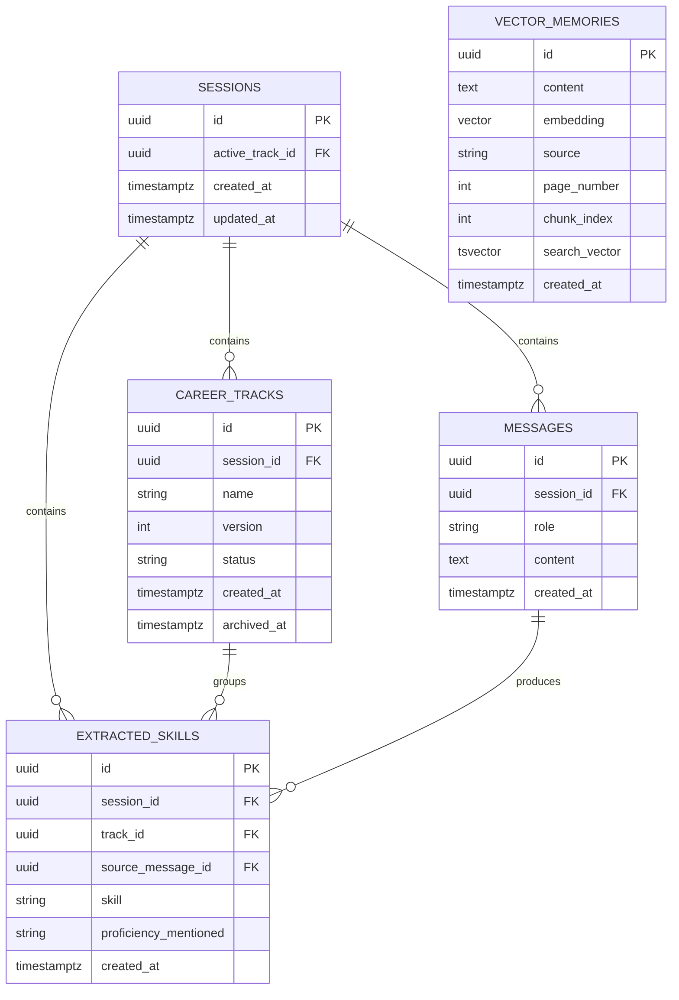

# Database Entity Relationship Diagram

**Project:** Career Path Strategist  
**Status:** Proposed design  
**Related Issue:** #1

## 1. Overview

The system uses PostgreSQL with pgvector for relational persistence and semantic retrieval.

The proposed database contains five principal entities:

1. **Sessions:** Conversation-session metadata.
2. **Messages:** User and assistant conversation history.
3. **CareerTracks:** Active and archived career directions.
4. **ExtractedSkills:** Skills and proficiency levels extracted from messages.
5. **VectorMemories:** Embedded reference passages used in retrieval.

CareerTracks is included to support career switching without deleting previously extracted skills.

## 2. Entity Relationship Diagram

The active-track reference from Sessions to CareerTracks is an additional foreign-key relationship.

## 3. Entity Descriptions

### 3.1 Sessions

Represents an individual conversation.

- `id`: Primary key.
- `active_track_id`: References the currently active career track.
- `created_at`: Session creation timestamp.
- `updated_at`: Last update timestamp.

A session can contain multiple messages and career tracks.

### 3.2 Messages

Stores the entire conversation history.

- `id`: Primary key.
- `session_id`: References Sessions.
- `role`: Identifies user or assistant messages.
- `content`: Message body.
- `created_at`: Message timestamp.

Messages are retained when a user changes career direction.

### 3.3 CareerTracks

Represents a specific career direction within a session.

- `id`: Primary key.
- `session_id`: References Sessions.
- `name`: Career direction, such as Data Scientist.
- `version`: Career-track version.
- `status`: Active or archived.
- `created_at`: Creation timestamp.
- `archived_at`: Archive timestamp.

When a career switch occurs, the previous track becomes archived and a new active track is created.

### 3.4 ExtractedSkills

Stores validated skill-extraction results.

- `id`: Primary key.
- `session_id`: References Sessions.
- `track_id`: References CareerTracks.
- `source_message_id`: References the message from which the skill was extracted.
- `skill`: Name of the extracted skill.
- `proficiency_mentioned`: beginner, intermediate, advanced or unspecified.
- `created_at`: Extraction timestamp.

Skills remain associated with their original career track after archival.

### 3.5 VectorMemories

Stores reference passages for Retrieval-Augmented Generation.

- `id`: Primary key.
- `content`: Extracted passage.
- `embedding`: Vector representation.
- `source`: Reference document identifier.
- `page_number`: Source page.
- `chunk_index`: Chunk order within the source.
- `search_vector`: PostgreSQL full-text search representation.
- `created_at`: Ingestion timestamp.

VectorMemories is independent of individual chat sessions because it represents the shared reference knowledge base.

## 4. Referential Integrity

The following rules are proposed:

- Deleting a session cascades to its messages, career tracks and extracted skills.
- Deleting a career track cascades to its extracted skills.
- Deleting a message cascades to skills extracted from that message.
- The active-track reference uses `ON DELETE SET NULL` to avoid a blocking circular deletion dependency.
- Composite foreign keys or equivalent database constraints will ensure the active track, messages and skills belong to the same session.

Career switching uses archival instead of deletion to preserve historical skills.

## 5. Constraints and Indexes

Recommended constraints include:

- Primary keys on all entity IDs.
- Foreign keys with explicit deletion behavior.
- Valid message roles.
- Valid skill proficiency values.
- Valid career-track statuses.
- Unique career-track version per session.
- At most one active career track per session.
- Unique source and chunk index for reference passages, subject to the ingestion versioning strategy.

Recommended indexes include:

- `messages(session_id, created_at, id)`
- `career_tracks(session_id, version)`
- `extracted_skills(track_id)`
- GIN index on `vector_memories.search_vector`
- pgvector cosine-search index on `vector_memories.embedding`

The embedding dimension and vector-index strategy will be selected after the embedding model is chosen.

## 6. Career-Switch Example

Assume a user first explores software engineering and later switches to data science.

**Before switching**

- Session: S1
- Active track: Software Engineer, version 1
- Extracted skills: Java, Git

**After switching**

- Session: S1
- Archived track: Software Engineer, version 1
- Active track: Data Scientist, version 2
- New extracted skills: Python, SQL

All previous messages and skills remain stored. The live skill tree displays skills associated with the active track.

Restoring the old track changes which track is active without deleting the newer track or conversation history.

## 7. Migration Strategy

Database schema evolution will use Alembic versioned migrations.

The first migration will:

1. Enable the pgvector extension.
2. Create the relational tables.
3. Apply primary and foreign key constraints.
4. Apply validation and uniqueness constraints.
5. Create initial database indexes.

Subsequent migrations will update the schema without requiring manual database reconstruction.

## 8. Design Status

This ERD is a proposed logical database design. The exact SQLAlchemy mappings, migration ordering, composite constraints and vector dimensions will be finalized during Milestone 1 implementation and documented in the database ADR.

The diagram and schema must be updated if implementation decisions change.