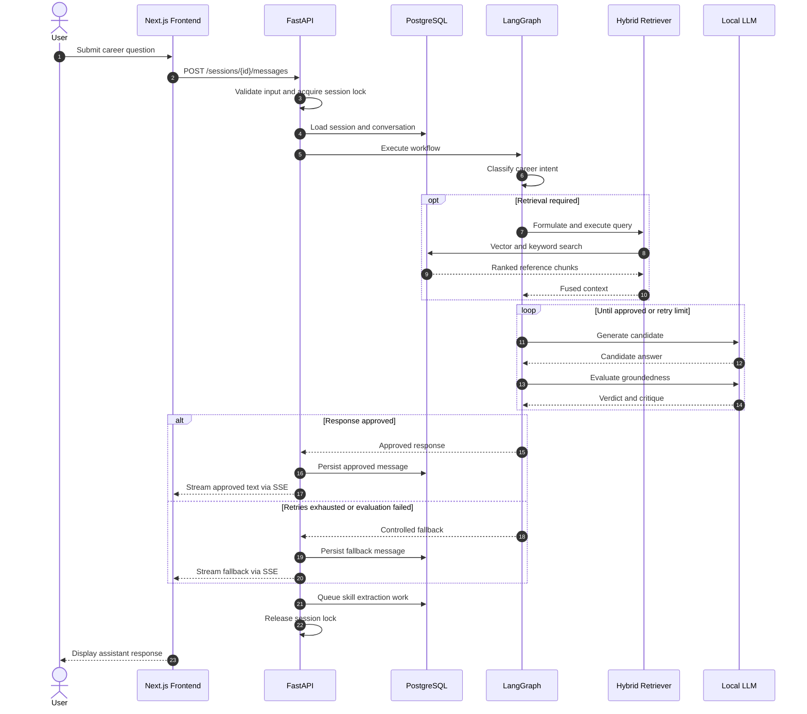
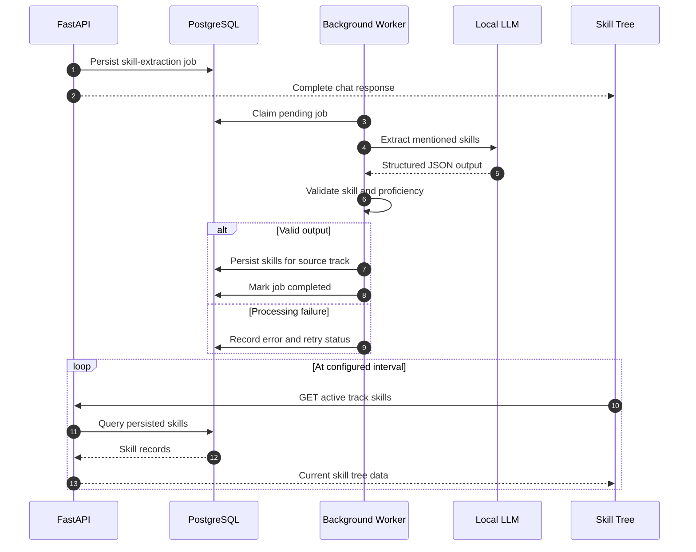
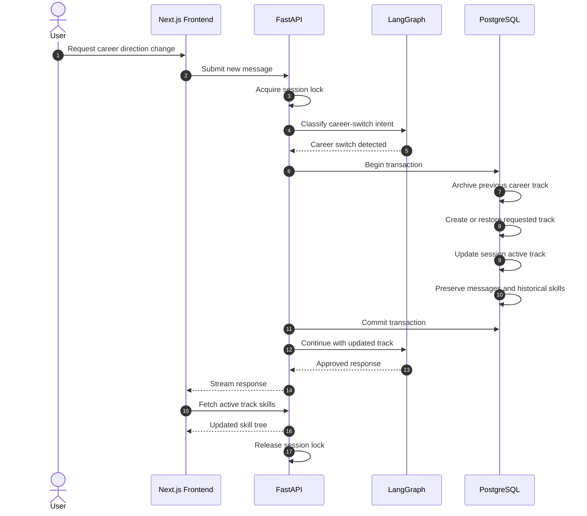

# Sequence Diagrams

**Project:** Career Path Strategist  
**Related Issue:** #1  
**Status:** Proposed design

## 1. Chat and Response Evaluation

The first implementation will evaluate candidate responses before making them visible. Therefore time-to-first-token includes evaluation time.

The session lock ensures messages in the same session are processed in a defined order.

## 2. Asynchronous Skill Extraction

Skill extraction is independent of the request-response path.

A durable job record is proposed to protect queued work from process restarts.

The extraction job stores the track identifier from the originating message, preventing delayed work from being incorrectly assigned to a newer career track.

## 3. Career-Switch Handling

## 4. Proposed API Contracts

| Method | Endpoint | Purpose |
|---|---|---|
| POST | `/sessions` | Create conversation session |
| GET | `/sessions/{id}` | Retrieve session information |
| POST | `/sessions/{id}/messages` | Process chat message and stream response |
| GET | `/sessions/{id}/messages` | Retrieve conversation history |
| GET | `/sessions/{id}/skills` | Retrieve active-track skills |
| GET | `/sessions/{id}/tracks` | Retrieve career-track history |
| POST | `/sessions/{id}/tracks/switch` | Switch or restore career direction |

These endpoints are proposed API contracts and may be refined during implementation.

## 5. Consistency and Concurrency

Operations modifying a session's active track must execute under session-level serialization.

Background extraction jobs retain their originating message and track identifiers.

Failed database transactions must roll back without leaving a partially changed career track.

## 6. Status

These diagrams describe the intended system interactions. They will be updated to match the implemented API and background-processing architecture.