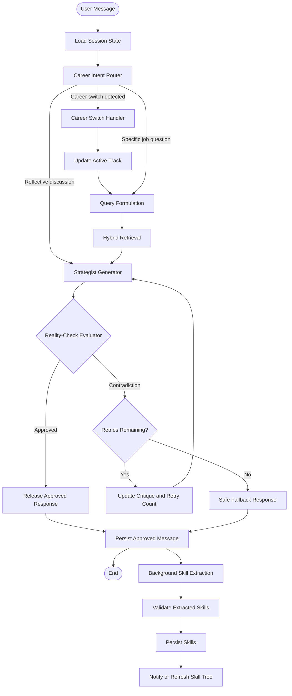

# LangGraph Workflow Design

**Project:** Career Path Strategist  
**Related Issue:** #1  
**Status:** Proposed design

## 1. Overview

The Career Path Strategist uses LangGraph to coordinate conversational career guidance, knowledge retrieval, grounded response generation, consistency evaluation, and career-switch handling.

The workflow uses typed Pydantic state and conditional edges.

## 2. Workflow Diagram

The dotted edge represents separately scheduled background work, not a blocking LangGraph operation.

The workflow is bounded by a maximum of three regeneration retries and a configured graph recursion limit.

## 3. Typed Workflow State

The proposed state contains:

| Field | Type | Purpose |
|---|---|---|
| messages | List | Conversation history |
| retrieved_context | List | Retrieved reference passages |
| route_decision | Enum | Job-specific, conversational, or career switch |
| critique | Optional string | Evaluator feedback |
| retry_count | Integer | Number of regeneration retries |
| active_career_track | Optional UUID | Current career direction |
| status | Enum | Processing, approved, failed, or fallback |
| candidate_response | Optional string | Unapproved response under evaluation |

The actual Pydantic schema will be implemented during Milestone 2.

## 4. Workflow Nodes

### 4.1 Career Intent Router

Classifies incoming messages.

Possible routes:

- Job-specific career question: retrieval required.
- Reflective or personal discussion: conversational path.
- Career direction change: career-switch handling.

### 4.2 Query Formulation

Transforms job-specific questions into retrieval-optimized queries.

For example:

User input:

"I want to become an ML engineer. What should I learn?"

Possible retrieval query:

"Machine Learning Engineer required technical skills tools qualifications career path"

### 4.3 Hybrid Retrieval

Performs semantic and keyword retrieval against the approved career reference corpus.

The retrieval results are fused using Reciprocal Rank Fusion.

### 4.4 Strategist Generator

Generates a candidate response using conversation history and relevant retrieved context.

Generated recommendations remain provisional until evaluation passes.

### 4.5 Reality-Check Evaluator

A separate model call checks whether recommendations contradict retrieved reference material.

If contradictions are detected, the evaluator produces a critique and sends the workflow back to the generator.

The maximum number of regeneration retries is three.

If evaluation still fails, the system returns a controlled fallback response.

For messages without relevant retrieved evidence, the system avoids making unsupported factual career requirements.

### 4.6 Career-Switch Handler

When the user intentionally changes career direction:

1. Identify the current career track.
2. Archive its existing skill records logically by archiving the track.
3. Create or restore the target career track.
4. Set the target track as active.
5. Preserve all prior conversation messages.

Changes are performed transactionally.

## 5. Streaming Strategy

A design challenge exists between streaming response tokens immediately and rejecting contradictory generated responses.

The proposed initial solution is **evaluate-before-release streaming**:

1. Generate a candidate response.
2. Evaluate its consistency.
3. Retry if necessary.
4. Stream only the approved response to the browser.

This avoids displaying rejected drafts.

The trade-off is increased time-to-first-token. The measured time-to-first-token will include generation and evaluation latency.

An alternative is provisional draft streaming with explicit client-side retraction, but this is not selected for the initial version.

## 6. Skill Extraction

Skill extraction must not block chat-response processing.

After the approved assistant message is persisted, a background job is scheduled to extract professional skills.

The extractor validates its results and stores them under the appropriate career track.

Failures are logged and handled independently from the chat workflow.

## 7. Failure Handling

| Failure | Planned behavior |
|---|---|
| Retrieval unavailable | Return a controlled, limited response |
| Generator timeout | Return a service error or fallback |
| Evaluator contradiction | Retry up to three times |
| Evaluator unavailable | Do not release unchecked career recommendations |
| Retry limit exhausted | Return a controlled fallback |
| Skill extraction failure | Log and retry independently |
| Session concurrency conflict | Process session messages in order |
| Graph recursion limit reached | Terminate safely and log the error |

## 8. Testing Requirements

Tests will cover:

- Intent routing.
- Query formulation.
- Retrieval routing.
- Evaluation approval.
- Contradictory responses.
- Three-retry exhaustion.
- Evaluator failures.
- Career-track switching.
- Preservation of conversation history.
- Non-blocking skill extraction.

At least ten consistent and contradicting evaluator cases will be documented during Milestone 2.

## 9. Status

This workflow is a proposed architecture for review. Exact model prompts, LangGraph node implementations and failure policies will be finalized during implementation.